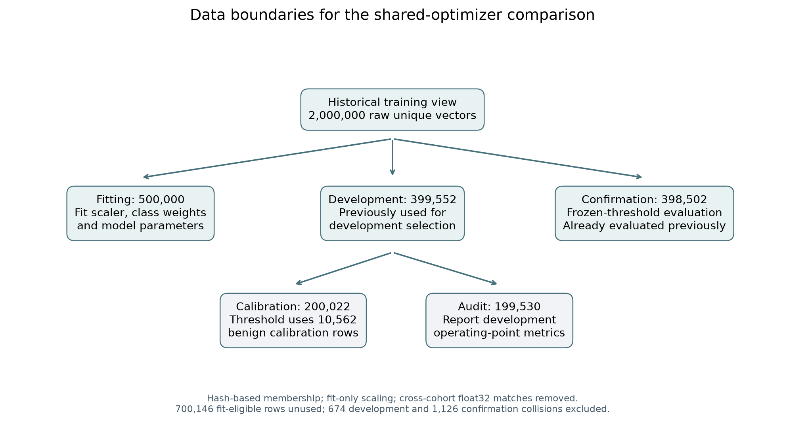

# Set-up and methodology

This draft describes the final shared-optimizer comparison and the retrospective
matched-method supplement. The earlier 46-feature experiments and the completed
official39 cloud baseline are distinct studies; their scores should not be placed
in the same table as if they used the following cohorts and settings.

## Dataset and task definition

The study addresses eight-class classification of IoT network-flow statistics:
Benign, DDoS, DoS, Recon, Web-based, Brute Force, Spoofing and Mirai. CICIoT2023
was collected using a topology of 105 devices and contains attacks grouped into
seven attack categories [1]. The available flow statistics do not supply the
device identities needed to treat our simulated clients as individual physical
devices. Consequently, the study evaluates classification within a collection,
not generalization to identified devices or unseen capture sessions.

The final experiments use the **39 numeric features in the downloaded official
source**, rather than the 46-feature partial Kaggle mirror used in the earlier
project stage. Features and label ordering are fixed in the data manifest. The
39-feature representation is not formed by filling missing legacy columns with
zero, and legacy scalers or checkpoints are not reused.

## Data cleaning and reproducible row selection

The source audit processed 46,776,697 readable records using bounded batches and
disk-backed files. Three malformed records and 1,037 readable records with
nonfinite features were excluded. Among the remaining finite occurrences,
21,055,707 distinct feature-vector groups were identified. Whole groups with
contradictory eight-class labels were excluded (461,347 groups), and one
representative was retained for each other vector. Thus, the experimental
population represents cleaned unique feature vectors, not the original frequency
of repeated flows. Excluding contradictory labels also makes the classification
task less ambiguous; results do not characterize all original records.

The initial official-data split assigns complete feature-vector groups to
approximately 80% training, 10% validation and 10% test through a fixed hash rule.
Source-file identity, record position and content hashes are retained for
reconstruction. Exact-duplicate grouping prevents copies of the same vector from
crossing those boundaries, but it does not remove all near-duplicate or
capture-session dependencies.

A historical two-million-row training view was selected from the official
training partition using class-proportional quotas. The quotas use largest-
remainder rounding, and vectors are ranked deterministically within classes by
SHA-256 with a fixed domain. Nested subset membership therefore does not depend
on file iteration order or observed model performance. This is separate from the
subsequent partition used for the shared-optimizer study.

## Fitting, development and confirmation cohorts

For the shared-optimizer study, each raw vector in the historical two-million-row
view receives a second deterministic hash. The first approximately 60% of the
hash range is eligible for fitting, the next 20% for development, and the final
20% for confirmation. Exactly 500,000 fitting vectors are selected by lowest
hash rank from the fitting-eligible pool; the remaining fitting-eligible rows are
unused. This second assignment is label independent, not a class-balanced split.

A new StandardScaler is fitted **only on those 500,000 fitting rows** using
incremental statistics. Transformations are calculated in float64 and then
converted to float32 for the model. No clipping is applied. Class weights and
the common loss denominator also use fitting labels only. These are pooled
preprocessing conveniences of a simulated study, not a demonstrated private
distributed preprocessing protocol.

Distinct raw vectors can become identical after scaling and float32 conversion.
A label-independent collision check gives priority to fitting data, then
development, then confirmation. It removes 674 development rows overlapping
fitting inputs and 1,126 confirmation rows overlapping fitting or development
inputs. Final cohort sizes are:

| Class | Fitting | Development | Confirmation |
| --- | ---: | ---: | ---: |
| Benign | 26,453 | 21,193 | 21,024 |
| DDoS | 294,864 | 235,894 | 234,764 |
| DoS | 90,410 | 72,090 | 72,208 |
| Recon | 16,574 | 13,246 | 13,308 |
| Web-based | 599 | 495 | 500 |
| Brute Force | 332 | 250 | 260 |
| Spoofing | 11,147 | 8,696 | 8,803 |
| Mirai | 59,621 | 47,688 | 47,635 |
| **Total** | **500,000** | **399,552** | **398,502** |

The development cohort supports the earlier bounded learning-rate selection and
analysis. For alarm calibration, identical standardized vectors are grouped and
assigned by another fixed hash to **200,022 calibration rows** and **199,530
development-audit rows**. There are 10,562 benign calibration rows. Thresholds
are fitted using only those benign calibration scores; the audit partition is
used to report the resulting operating point. Because the complete development
cohort had already been used in model selection, its audit partition is not an
independent final test.

The 398,502-row confirmation cohort was reserved for the original shared-
optimizer extension and scored only after its models and thresholds were locked.
However, its source rows had previously appeared in the project's historical
training collection. It is therefore within-collection confirmation, not an
external benchmark. It has now been evaluated: the later all-method comparison
is explicitly **retrospective** and does not restore an untouched holdout by
calling the same rows validation or confirmation again. The original official
validation and test arrays are not reopened for this supplement.

## Simulated federation and common classifier

Twenty virtual clients retain the fixed ownership assignments inherited from
the historical non-IID partition. Their fitting-subset populations are recomputed
after row selection, and aggregation weights are proportional to the number of
assigned fitting rows. All clients participate. Client ownership is not redrawn
for each algorithm or training seed. The design tests three training seeds under
one client partition, not robustness to many independent partitions or devices.

All matched methods use the same 39-input multilayer perceptron, two hidden
layers with 64 and 32 units, ReLU activations, LayerNorm, zero dropout and an
eight-logit output. The model has 5,096 parameters. Centralized-light training
uses the pooled fitting cohort; federated computations restrict each local
gradient to the client's assigned rows. The separate centralized-heavy model
is not a comparator in this matched optimizer study.

The loss is square-root inverse-frequency weighted cross-entropy with a fixed
denominator equal to the expected target weight over fitting data. Using this
global denominator avoids changing the loss normalization with each client's
minibatch class mixture. It does not make multiple local optimizer steps
equivalent to centralized training. Minibatches contain 500 rows sampled
uniformly with replacement within a client, or from the pooled fitting set for
centralized controls.

Specifically, for fitting class count `n_c`, weights are proportional to
`1/sqrt(n_c)`. For minibatch B, the task loss is the mean of
`w_y * cross_entropy(logits, y)` divided by the fixed fitting expectation
`sum_c (n_c/N) * w_c`, where N=500,000. The same fixed denominator is used by
every client. A client's aggregation weight is `p_i = n_i/N`, based on its
assigned fitting population, not on the equal number of sampled local steps.

## Training methods and matched controls

FedAvg aggregates locally trained models using client population weights [2].
The Adam variant used here resets each client's Adam state at the beginning of
each round and performs 20 local steps. FedProx retains this schedule and adds
the penalty `mu/2 * ||w_local - w_round_start||^2` [3]. Both previously considered
coefficients, 0.01 and 0.1, are reported; neither is selected retrospectively
using confirmation performance.

SCAFFOLD uses client and server control vectors to correct local gradient drift
[4]. Our full-participation, population-weighted implementation uses plain SGD
and the Option II control update, with no momentum, clipping or weight decay.
It is compared with **FedAvg-SGD and centralized-SGD at the same learning rate**.
Comparing SCAFFOLD only against FedAvg-Adam would confound gradient correction
with the choice of optimizer.

The full MIME implementation combines gradient correction with server optimizer
statistics [5]. Its local steps use frozen, lagged moments rather than ordinary
bias-corrected PyTorch Adam. A centralized version of that base updater is
included as a control. All full-anchor gradients and both gradients in each
local correction are charged to the training-work budget.

Shared-gradient Adam collects client gradients at a common model, weights them
by client population and applies one persistent server Adam update. Clients do
not make local Adam updates. The compressed version retains the same update
schedule but quantizes uploads and delivered-model updates to signed four-bit
values in blocks of at most 128 coordinates. Per-block scales and persistent
residual feedback are retained. Evaluation uses the model delivered to clients,
not the server's hidden full-precision target.

| Configuration | Learning rate | Additional fixed setting |
| --- | ---: | --- |
| Centralized Adam | 0.001 | Persistent pooled optimizer |
| FedAvg-Adam | 0.003 | Reset local Adam; 20 local steps |
| FedProx-Adam | 0.003 | Separate mu=0.01 and mu=0.1 arms |
| Centralized SGD, FedAvg-SGD and SCAFFOLD | 0.01 | No momentum or weight decay |
| Central MIME base and full MIME | 0.003 | Lagged moments; initial second moment 0.0001 |
| Shared-gradient Adam and compressed shared-gradient Adam | 0.003 | Persistent server optimizer |

Adam uses beta1=0.9, beta2=0.99, epsilon=0.001 and no weight decay. MIME uses
the corresponding coefficients in its own lagged-moment formula. Rates for the
original Adam/MIME arms were chosen in earlier development experiments. The
additional FedProx and SCAFFOLD settings reuse historical engineering choices;
the retrospective supplement does not claim an equally extensive hyperparameter
search or the best achievable configuration for every algorithm.

## Budget, endpoints and performance measures

Every fresh run receives **21.6 million backward examples**, meaning examples
processed in gradient calculations, not unique rows. Centralized controls make
43,200 minibatch updates. FedAvg, FedProx and SCAFFOLD make 108 full-participation
rounds, each containing 20 local steps per client. Shared-gradient methods make
2,160 synchronization steps. Full MIME makes 24 rounds: 12 million anchor
backward examples and 9.6 million backward examples from paired local gradients.
Each MIME round has two logical communication barriers (anchor aggregation and
model aggregation), giving 48 barriers in total rather than 24.

Equal backward-example budgets do not imply equal FLOPs, optimizer calls,
wall-clock time, synchronization rounds or network traffic. These quantities
are reported separately. The three seeds are 7, 17 and 27; initialization is
paired within each seed, and FedAvg, FedProx and SCAFFOLD use the same client
sample streams. Shared-gradient Adam and its compressed version also use paired
streams, with a different ordering of client visits from the local-step arms.
MIME uses fewer local blocks plus full anchors. Pooled centralized sampling is
not the same realized row order. The
final budget endpoint is used for every method, without selecting the best
intermediate checkpoint or extending a weak run.

Macro-F1 is the primary classification metric, accompanied by all eight class
recalls, precision, F1, supports and confusion matrices. Benign false-alert rate
is the fraction of true benign rows assigned any attack label. Attack detection
and correct attack-category recognition are reported separately. Means weight
the three seeds equally; sample standard deviations summarize training variation,
not statistical uncertainty across independent datasets.

To compare alarm behavior, each model uses the margin between its largest attack
logit and its benign logit. It predicts the highest-scoring attack only when that
margin exceeds its development-calibrated threshold; otherwise it predicts
Benign. The primary calibration target is 5%, with 1%, 10% and 20% retained as
secondary targets. The threshold is the observed order statistic allowing at
most `floor(0.05 * n_benign)` calibration false alerts; boundary ties remain
benign. All thresholds are saved before confirmation scoring. Actual evaluation
false-alert rates are reported and are not forced to equal 5%. Differences over
0.5 percentage points are flagged as not alarm-matched under the historical
comparison rule.

Application payload and synchronization counts describe communication costs.
Uncompressed values use explicit model-sized FP32 message accounting; compressed
values count actual serializer lengths, including scales and message metadata.
These are not measurements of traffic over a physical network. Compression
does not reduce the shared-gradient method's synchronization frequency or imply
a privacy guarantee.

## Computational environment and reproducibility

Earlier baseline, scaling and diagnostic experiments were run on RONIN NVIDIA
Tesla T4 cloud instances. The cloud records identify Ubuntu 22.04, Python 3.12
and PyTorch 2.7.0 with CUDA 12.8. These experiments have their own data protocols,
configuration records and timing scopes. Their hardware must not be assigned
retrospectively to experiments run elsewhere.

The final shared-optimizer study used **local CPU execution on macOS ARM**.
The current matched-method supplement also runs on CPU, on an Apple M3 workstation
with 16 GiB RAM, Python 3.13.9, PyTorch 2.14.0 and NumPy 2.5.3, using two
intra-operation threads and one inter-operation thread. The GPU is not used by
this runner. Federation is simulated sequentially on one machine; custom PyTorch
optimizer code and Flower aggregation helpers are not a physically distributed
deployment.

A separate teammate replication of compressed shared-gradient Adam ran on a
WSL2 x86-64 CPU with PyTorch 2.14.0+cu130. It achieved mean confirmation macro-F1
0.6328 versus 0.6325 on the original Mac runtime. Initialization and final
numerical states were not bitwise identical. This supports close observed
cross-platform performance for that method, not CPU/GPU equivalence for all
algorithms or a claim that the final models were trained on a Tesla T4.

Prepared inputs, source code, sampled-row streams, settings and checkpoints are
identified by checksums. Recovery tests replay serialized optimizer and control
states. No physical edge-device latency, power consumption, privacy guarantee
or measured wide-area network performance is claimed. Local elapsed times are
run observations, not controlled hardware benchmarks.

## References and implementation evidence

1. [CICIoT2023 dataset description](https://www.unb.ca/cic/datasets/iotdataset-2023.html).
2. McMahan et al. (2017), [Communication-Efficient Learning of Deep Networks from Decentralized Data](https://proceedings.mlr.press/v54/mcmahan17a.html).
3. Li et al. (2020), [Federated Optimization in Heterogeneous Networks](https://arxiv.org/abs/1812.06127).
4. Karimireddy et al. (2020), [SCAFFOLD](https://proceedings.mlr.press/v119/karimireddy20a.html).
5. Karimireddy et al., [Mime: Mimicking Centralized Stochastic Algorithms in Federated Learning](https://arxiv.org/abs/2008.03606).

Project evidence: [source cleaning counts](../full_data_extension/results/README.md),
[row preparation](../../src/data/shared_optimizer_data.py),
[historical performance protocol](../federated_shared_optimizer/performance-plan.json),
[alarm calibration protocol](../federated_shared_optimizer/alarm-plan.json),
[original confirmation](../federated_shared_optimizer/confirmation-results.json),
[cloud environment records](../cloud_study_2026_10_06/results/summary.json),
[new matched-comparison plan](plan.json), and
[new runner](../../src/eval/methodology_comparison.py).
