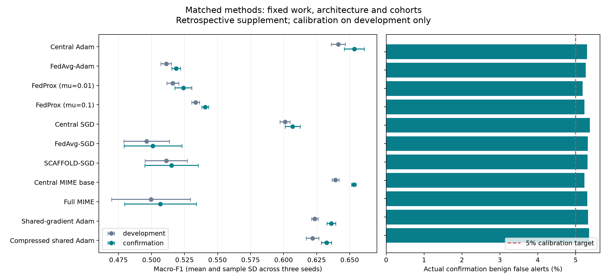
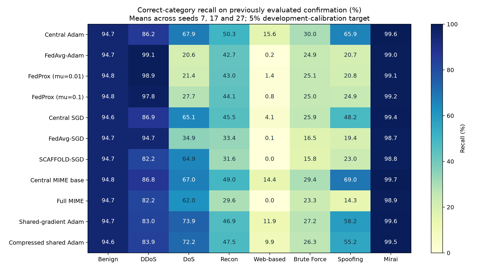

# Matched methodology comparison results

This is a retrospective comparison, not a new untouched test. All 33 models were trained from scratch on CPU.

Primary scores use the same 5% development-calibration false-alert target. Thresholds were saved before confirmation scoring.

| Method | Development audit F1 | Confirmation F1 (mean +/- SD) | Confirmation FAR | Payload MB | Rounds (barriers) |
| --- | ---: | ---: | ---: | ---: | ---: |
| Central Adam | 0.6414 | 0.6535 +/- 0.0076 | 5.30% | 0.00 | 0 (0) |
| FedAvg-Adam | 0.5112 | 0.5187 +/- 0.0033 | 5.27% | 88.06 | 108 (108) |
| FedProx (mu=0.01) | 0.5162 | 0.5241 +/- 0.0064 | 5.18% | 88.06 | 108 (108) |
| FedProx (mu=0.1) | 0.5334 | 0.5407 +/- 0.0025 | 5.23% | 88.06 | 108 (108) |
| Central SGD | 0.6011 | 0.6068 +/- 0.0057 | 5.37% | 0.00 | 0 (0) |
| FedAvg-SGD | 0.4963 | 0.5010 +/- 0.0219 | 5.32% | 88.06 | 108 (108) |
| SCAFFOLD-SGD | 0.5112 | 0.5151 +/- 0.0202 | 5.32% | 176.12 | 108 (108) |
| Central MIME base | 0.6393 | 0.6532 +/- 0.0018 | 5.23% | 0.00 | 0 (0) |
| Full MIME | 0.4996 | 0.5067 +/- 0.0272 | 5.31% | 58.71 | 24 (48) |
| Shared-gradient Adam | 0.6236 | 0.6361 +/- 0.0033 | 5.33% | 1761.18 | 2,160 (2,160) |
| Compressed shared Adam | 0.6219 | 0.6325 +/- 0.0038 | 5.36% | 240.26 | 2,160 (2,160) |

Equal backward-example budgets do not imply equal communication, FLOPs, optimizer calls or training time. FP32 payloads use raw model-vector accounting; compressed payloads include serializer metadata and initialization.

## Per-class recall

| Method | Benign | DDoS | DoS | Recon | Web-based | Brute Force | Spoofing | Mirai |
| --- | ---: | ---: | ---: | ---: | ---: | ---: | ---: | ---: |
| Central Adam | 94.70% | 86.24% | 67.90% | 50.27% | 15.60% | 30.00% | 65.92% | 99.62% |
| FedAvg-Adam | 94.73% | 99.07% | 20.61% | 42.70% | 0.20% | 24.87% | 20.66% | 99.00% |
| FedProx (mu=0.01) | 94.82% | 98.94% | 21.44% | 43.05% | 1.40% | 25.13% | 20.82% | 99.06% |
| FedProx (mu=0.1) | 94.77% | 97.80% | 27.74% | 44.10% | 0.80% | 25.00% | 24.94% | 99.16% |
| Central SGD | 94.63% | 86.87% | 65.10% | 45.48% | 4.13% | 25.90% | 48.19% | 99.41% |
| FedAvg-SGD | 94.68% | 94.67% | 34.85% | 33.41% | 0.07% | 16.54% | 19.37% | 98.75% |
| SCAFFOLD-SGD | 94.68% | 82.15% | 64.87% | 31.63% | 0.00% | 15.77% | 23.05% | 98.76% |
| Central MIME base | 94.77% | 86.83% | 66.96% | 48.95% | 14.40% | 29.36% | 69.03% | 99.70% |
| Full MIME | 94.69% | 82.24% | 62.04% | 29.57% | 0.00% | 23.33% | 14.31% | 98.89% |
| Shared-gradient Adam | 94.67% | 83.02% | 73.85% | 46.86% | 11.87% | 27.18% | 58.23% | 99.57% |
| Compressed shared Adam | 94.64% | 83.93% | 72.25% | 47.53% | 9.87% | 26.28% | 55.17% | 99.51% |

## Audit and limitations

All 363 confusion-matrix endpoints independently reproduce class and aggregate metrics. Every run passed serialized recovery.

Historical controls reproduced exactly: 12/12 model/logit/metric endpoints. Paired operating-point comparisons within 0.5 percentage points of actual FAR: 36/36.

Training processed 712,800,000 backward examples, plus 11,529,000 separately counted recovery examples.

SCAFFOLD must be interpreted against FedAvg-SGD and Central SGD; MIME has its own central-base control. Learning rates were fixed from historical development/engineering choices, not exhaustively optimized for each method.

The confirmation rows, client partition and training seeds were already used in the project. This supplement cannot establish external generalization or a new independent confirmation.

Full results and per-seed paired false-alert checks: [results.json](results.json). Reproduction instructions and implementation inventory: [README](README.md).
