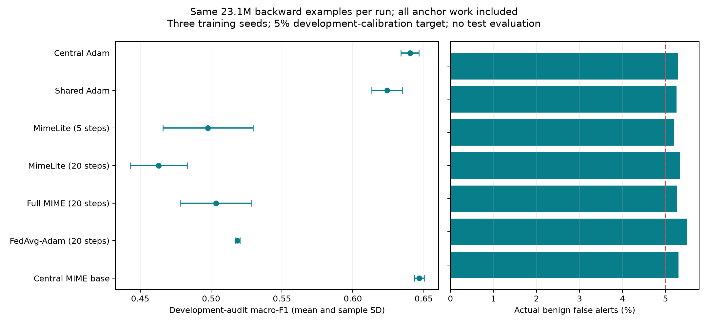
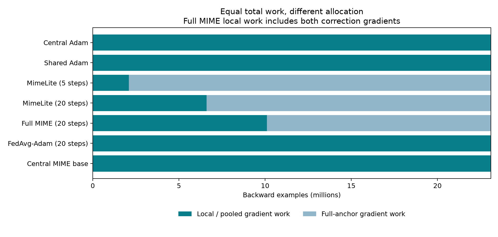
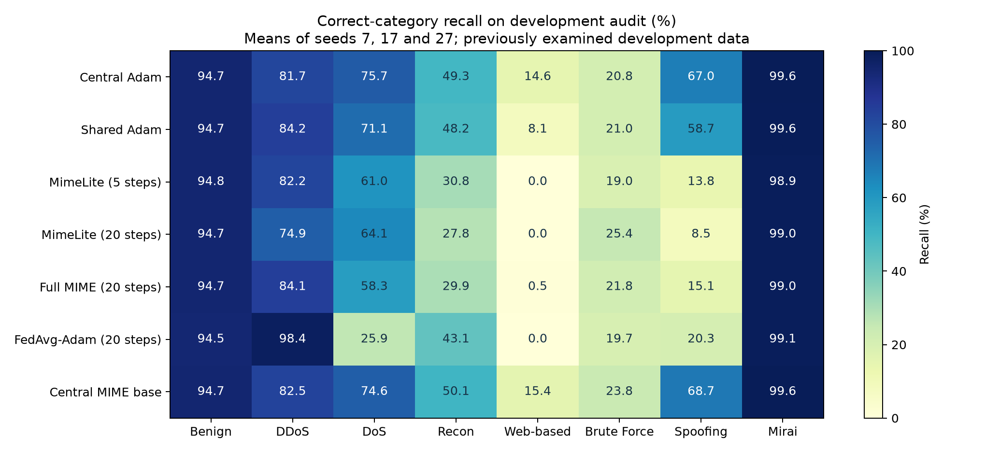

# Full-anchor MimeLite: fair-work development comparison

These are new final endpoints at **23.1 million backward examples per run**, including all anchors. They are not attempts to reproduce the untraceable MimeLite scores or replacements for the historical confirmation results.

Means and sample SD use seeds 7, 17 and 27. Thresholds use the same 5% benign calibration target; actual audit false alerts are reported. All evaluation is on previously examined development data.

| Method | Macro-F1 mean +/- SD | Actual FAR | Rounds | Barriers | Payload MB |
| --- | ---: | ---: | ---: | ---: | ---: |
| Central Adam | 0.6403 +/- 0.0064 | 5.30% | 0 | 0 | 0.00 |
| Shared Adam | 0.6241 +/- 0.0107 | 5.26% | 2,310 | 2,310 | 1883.48 |
| MimeLite (5 steps) | 0.4978 +/- 0.0319 | 5.20% | 42 | 42 | 85.61 |
| MimeLite (20 steps) | 0.4630 +/- 0.0201 | 5.34% | 33 | 33 | 67.27 |
| Full MIME (20 steps) | 0.5034 +/- 0.0249 | 5.27% | 26 | 52 | 63.60 |
| FedAvg-Adam (20 steps) | 0.5186 +/- 0.0018 | 5.51% | 116 | 116 | 94.58 |
| Central MIME base | 0.6468 +/- 0.0034 | 5.30% | 0 | 0 | 0.00 |

Payload is modeled FP32 application traffic, not a physical network measurement. One MB is 1,000,000 bytes. Equal backward examples do not mean equal FLOPs, elapsed time, communication or tuning effort.

## Work allocation

## Per-class recall

| Method | Benign | DDoS | DoS | Recon | Web-based | Brute Force | Spoofing | Mirai |
| --- | ---: | ---: | ---: | ---: | ---: | ---: | ---: | ---: |
| Central Adam | 94.70% | 81.74% | 75.67% | 49.34% | 14.57% | 20.77% | 66.97% | 99.61% |
| Shared Adam | 94.74% | 84.18% | 71.11% | 48.23% | 8.15% | 21.03% | 58.72% | 99.56% |
| MimeLite (5 steps) | 94.80% | 82.20% | 61.00% | 30.82% | 0.00% | 18.97% | 13.75% | 98.87% |
| MimeLite (20 steps) | 94.66% | 74.94% | 64.09% | 27.79% | 0.00% | 25.38% | 8.55% | 99.02% |
| Full MIME (20 steps) | 94.73% | 84.07% | 58.28% | 29.95% | 0.49% | 21.79% | 15.06% | 98.95% |
| FedAvg-Adam (20 steps) | 94.49% | 98.36% | 25.90% | 43.09% | 0.00% | 19.74% | 20.31% | 99.10% |
| Central MIME base | 94.70% | 82.48% | 74.61% | 50.10% | 15.43% | 23.85% | 68.69% | 99.64% |

## Validation

All 21 runs passed exact serialized recovery, including shortened final rounds. All 15 historical model/logit/metric/work/sample bridges matched exactly at 21.6M before continuing.

Independently checked 126 confusion-matrix endpoints. Training processed 485,100,000 backward examples; recovery checks separately processed 12,966,000.

Paired comparisons within 0.5 percentage points of actual FAR: 35/36. All comparisons, including any failures, are retained in results.json.

These fixed settings were declared before training. They do not establish optimal hyperparameters, convergence, external generalization or privacy. Confirmation and original validation/test arrays were not evaluated.

[Protocol and commands](README.md) | [Full numerical evidence](results.json) | [Per-seed metrics](per-seed-metrics.csv)
