# Centralized and federated learning for IoT intrusion classification

## Tradecraft integrated thesis draft

DSA4266 Group 8 | 14 October 2026

### Abstract

An intrusion classifier must recognize attacks without overwhelming users with false alerts. This study investigates that trade-off for compact and larger neural networks trained centrally or through simulated federation on CICIoT2023. The task distinguishes benign traffic from seven attack categories. Macro-F1, every class's recall, benign false alerts and computational or communication requirements are considered together.

Three separately evaluated studies form the investigation. In the original 46-feature configured-model comparison, a 198,984-parameter heavy network attained mean validation macro-F1 of 0.6747, compared with 0.6583 for a 5,544-parameter centralized-light model. IID and non-IID federated-light models attained 0.6328 and 0.5557. Configuration differences and validation-based checkpoint selection limit causal interpretation. A subsequent official39 experiment used the same light architecture across training settings and two million training rows. Its final-test macro-F1 means were 0.6567 centrally, 0.6117 under IID federation and 0.4049 under controlled non-IID federation. Several rare categories remained poorly recognized.

A final extension changed the update procedure rather than adding another classifier. On 398,502 reserved confirmation rows, compressed shared Adam achieved macro-F1 of 0.6325 against 0.5187 for its paired FedAvg control and 0.6535 centrally. It reduced the uncompressed shared-gradient application payload by 86.4%, while retaining 20 times the synchronization count of FedAvg. Actual benign false alerts remained approximately 5.3%, and rare-class recall remained weak.

The principal finding is that update design can recover much of the centralized performance gap in this simulated setting, but that compactness, low communication volume and low false-alert burden are distinct objectives. Attribution studies identify recurring flow features and sensitive explanations, not causal security rules. The evidence supports a reproducible quality-cost trade-off, not a deployment-ready detector, a general rare-class solution or an independently established new optimization algorithm.

<!-- pagebreak -->

## 1. Introduction and research questions

Network intrusion detection is not adequately summarized by the percentage of correctly classified flows. If common attack categories dominate a collection, a classifier can perform well on those categories while failing the ones for which detection is most needed. Conversely, a system that rarely raises an alarm may appear unobtrusive while classifying attacks as benign. Tradecraft therefore treats attack coverage, benign false alerts and resource requirements as joint outcomes.

The project asks whether a compact, federated-trained model can offer a useful alternative to a larger centralized model. The scope is deliberately narrower than a production security platform: eight-class prediction from numeric network-flow statistics, simulated virtual clients, and analysis of the trained models. The available CSV features do not provide a usable device-identity topology. No per-device graph, physical edge deployment or device-specific vulnerability inference is part of the experiment.

Four questions organize the study. First, what quality and model-size trade-offs emerge among the original heavy, light and federated configurations? Second, how do IID and heterogeneous client allocations differ when the light architecture is held fixed? Third, can shared optimization and compression narrow the non-IID performance gap without concealing communication or false-alert costs? Fourth, what can class-level errors and attribution diagnostics legitimately contribute to security interpretation?

The investigation developed in stages because the initial failures admitted several explanations: model capacity, preprocessing, class imbalance, data scale, client heterogeneity and update dynamics. The thesis does not treat every exploratory attempt as a separate main contribution. Its main evidence consists of the original configured-model comparison, the completed official39 baseline and the prospectively locked optimizer confirmation. Earlier controls explain why those comparisons were chosen.

The contribution is empirical and methodological. A single pipeline supports reproducible data handling, interrupted-run recovery, class-level reporting and explicit evaluation boundaries. The positive result is a confirmed optimizer trade-off under one protocol. The negative results establish where additional data, larger models or favorable aggregate scores did not yield satisfactory rare-category recognition.

<!-- pagebreak -->

## 2. Background and methodological foundations

The [CICIoT2023 release](https://www.unb.ca/cic/datasets/iotdataset-2023.html) describes 33 attacks generated in a topology of 105 devices and groups them into seven categories. Tradecraft retains those categories and adds benign traffic as the eighth class. The task therefore differs from binary attack detection: confusing DoS with DDoS is an error even when both predictions would raise an attack alert.

The project was motivated by [Diaz-Gorrin et al. (2026)](https://doi.org/10.3390/app16031442), who investigated an auxiliary-classifier generative adversarial network on a Jetson Orin Nano. Their focus on TCP-related threats and binary classification is not the same benchmark as this eight-class study. Their physical deployment motivates the resource question; it does not supply measured latency, power or memory for Tradecraft. No direct numerical performance comparison with that paper is made here.

[Federated averaging](https://proceedings.mlr.press/v54/mcmahan17a.html) combines locally computed model updates while reducing the need for synchronized communication at every learning step. That communication advantage creates a relevant tension: clients trained on different class mixtures can take different local trajectories before aggregation. In this project, clients are simulated subsets rather than real devices. Pooled preprocessing and available global class counts are conveniences of the simulation, not proof of a fully decentralized privacy-preserving system.

[Adam](https://arxiv.org/abs/1412.6980) maintains adaptive moment estimates. The final extension asks whether maintaining a shared optimizer over aggregated client gradients is preferable to the tested reset-client Adam configuration. [Error-feedback compression](https://proceedings.mlr.press/v97/karimireddy19a.html) motivates retaining information omitted by quantization for later updates. These are established mechanisms. Combining them here is an application-specific experimental design, not evidence that the underlying optimization ideas are new.

[Integrated gradients](https://proceedings.mlr.press/v70/sundararajan17a.html) and [SHAP expected gradients](https://shap.readthedocs.io/en/latest/generated/shap.GradientExplainer.html) relate model-output differences to input features against reference inputs. Their outputs depend on the model, background and numerical approximation. The original study uses SHAP GradientExplainer; the official39 study uses background-averaged integrated gradients. Their names and diagnostic requirements are retained separately throughout the analysis.

<!-- pagebreak -->

## 3. Study structure and data boundaries

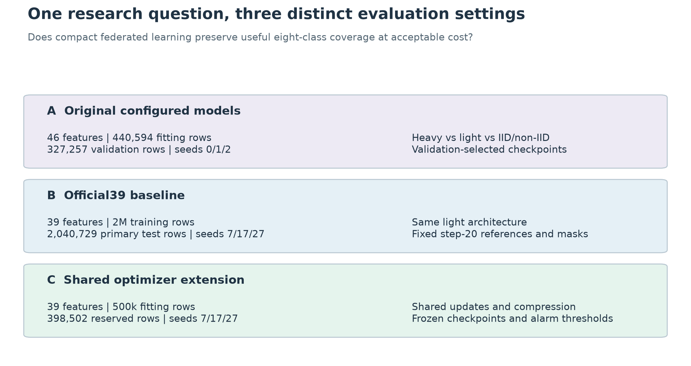

Figure 1. The panels describe the progression of research questions, not a common leaderboard. Rows, features, checkpoint rules and decision thresholds differ between studies.

The original 46-feature study uses a partial Kaggle mirror supplied as upstream train, validation and test files. Sampling stays within those boundaries. The completed configured-model comparison uses 440,594 training rows and 327,257 validation rows. Its test split had been inspected earlier in the project; it cannot be relabeled as fresh confirmation. The reported comparison is explicitly validation based.

The downloaded official release used by the extension has 39 numeric features. Its preprocessing and models are separate from the legacy pipeline. Duplicate-grouped within-collection splitting keeps identical feature vectors together, but does not establish capture-session independence. The final baseline's primary population additionally excludes exact model-input overlaps with training or validation under any evaluated feature mask.

The shared-optimizer experiment reserves fitting, development and confirmation membership within a historical two-million-row training view. It provides a clearer boundary against direct selection on its confirmation rows, but those rows still belong to a previously investigated collection. Scores from this experiment must be compared with its own controls, not subtracted from the earlier final-test scores as if only the optimizer had changed.

<!-- pagebreak -->

## 4. Common implementation and evaluation principles

All labels follow the repository's canonical mapping: Benign, DDoS, DoS, Recon, Web-based, Brute Force, Spoofing and Mirai. Feature ordering and fitted preprocessing are retained with each experiment. Large files are processed through bounded sampling or disk-backed arrays rather than loading the complete release into memory. Seeds, source identities, data identities, configuration and checkpoint selection are logged so that a score can be traced to a specific run.

### Architectures and training settings

| Setting | Hidden layers | Parameters | Normalization and dropout |
| --- | --- | ---: | --- |
| Legacy heavy | 512, 256, 128, 64 | 198,984 | BatchNorm, 0.3 |
| Legacy central light | 64, 32 | 5,544 | BatchNorm, 0.2 |
| Legacy federated light | 64, 32 | 5,544 | LayerNorm, 0.2 |
| Official39 baseline light | 64, 32 | 5,096 | LayerNorm, 0.2 |
| Shared-optimizer study light | 64, 32 | 5,096 | LayerNorm, 0.0 |

The original configured-model study uses square-root-weighted cross-entropy, Adam learning rate 0.001, batch size 512 and weight decay 0.00001. Each run receives 60 epochs or rounds, with its first strict maximum validation macro-F1 retained. Federation uses 20 clients, full participation, one local epoch per round and a fixed partition seed. Non-IID assignment uses Dirichlet alpha 0.5. Equal epoch and round counts do not imply identical optimizer trajectories.

The official39 baseline retains learning rate 0.001, batch size 512 and weight decay 0.00001, at 20 epochs or full-participation rounds. The later optimizer study uses batch size 500, Adam moments (0.9, 0.99), epsilon 0.001 and no weight decay. Development selection fixes learning rate 0.001 centrally and 0.003 for FedAvg and both shared variants. These are protocol differences, not settings chosen on confirmation. Sources: [official39 recipe](../full_data_extension/ablation-confirmation-plan.json), [optimizer design](../federated_shared_optimizer/performance-plan.json) and [replication settings](../federated_shared_optimizer/replication-plan.json).

### Metrics and measurement scope

For each class, precision measures the fraction of its predictions that are correct, while recall measures the fraction of its true examples correctly identified. F1 is their harmonic mean; macro-F1 averages the eight class F1 values equally. Benign false-alert rate is the fraction of genuinely benign rows labeled as attacks. It is not the fraction of alerts that are false, which also depends on traffic prevalence.

Means weight training seeds equally. Sample standard deviations describe seed variation, not independent devices or datasets. Training-example counts, optimizer calls, synchronization rounds and bytes are reported separately because none is a universal compute-equivalence measure. GPU training times refer to the recorded training-and-validation scope. Model parameter counts are not peak memory, inference latency or edge power. Recovery pilots establish implementation parity, not predictive quality.

<!-- pagebreak -->

## 5. Original heavy and light model comparison

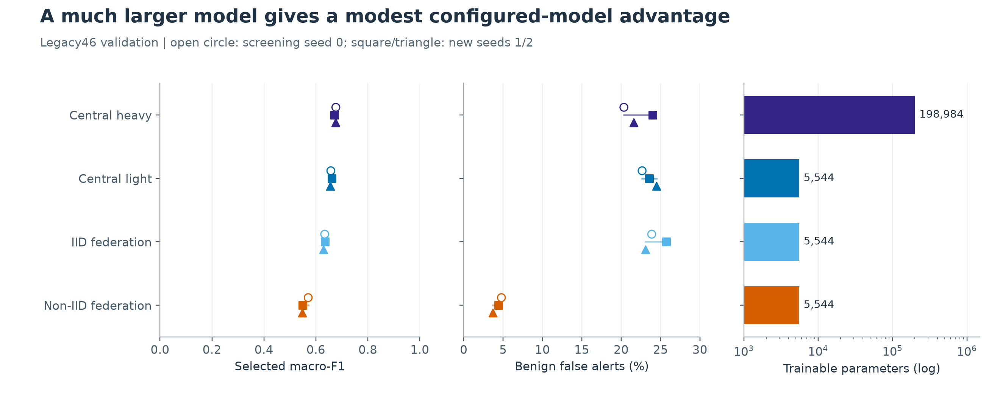

Figure 2. Every marker is a validation-selected endpoint. Open circles identify screening seed 0; squares and triangles identify new training seeds 1 and 2. The right axis is logarithmic. Parameter counts are not hardware benchmarks.

| Configured model | Macro-F1 mean and sample SD | New-seed mean | Mean false alerts |
| --- | --- | ---: | ---: |
| Central heavy | 0.6747 +/- 0.0031 | 0.6735 | 21.97% |
| Central light | 0.6583 +/- 0.0029 | 0.6587 | 23.57% |
| IID light | 0.6328 +/- 0.0024 | 0.6322 | 24.23% |
| Non-IID light | 0.5557 +/- 0.0128 | 0.5483 | 4.30% |

The ranking heavy, light, IID and non-IID holds at each seed. Heavy exceeds light by about 1.63 macro-F1 points with approximately 35.9 times as many parameters. This is a useful compactness trade-off, but dropout differs and the configurations were shortlisted using validation. The central-light versus federated-light comparison also changes normalization. Neither gap isolates a single causal factor.

Only seeds 1 and 2 were new after screening. Reporting them separately prevents the more exploratory seed 0 from being presented as fully prospective confirmation. Even the new seeds use the same validation rows and checkpoint-selection rule. The result is training-seed stability, not independent generalization evidence. Source: [configured-model evidence](../confirmation_2026_10_05/results/summary.json).

<!-- pagebreak -->

## 6. Class coverage in the original study

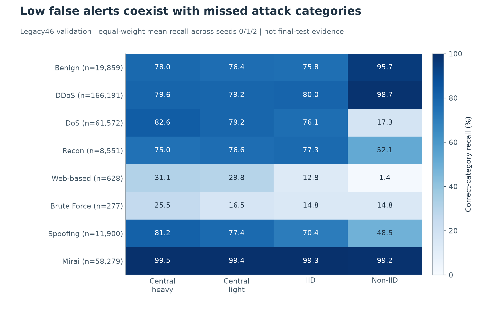

Figure 3. Mean recalls share a 0-100% color scale. Supports describe the same validation population for every model. The heatmap is not a pooled estimate over independent datasets.

The non-IID model's quiet alert stream is accompanied by weak DoS, Web-based and Brute Force coverage. Both new non-IID seeds have exactly zero Web-based recall. All three non-IID models identify only 14.80% of Brute Force rows, despite high DDoS and Mirai recall. The problem is therefore not visible from common-category performance alone.

The heavy network also remains imperfect. Web-based recall is 39.97% at seed 1 and 19.75% at seed 2, despite comparatively stable macro-F1. Central-light Brute Force recall averages 16.49%. A small aggregate standard deviation should not be interpreted as stable detection of every category.

The central and IID configurations label roughly 22-24% of benign validation traffic as attacks. These empirical proportions are not acceptable merely because their macro-F1 exceeds the non-IID result. The comparison motivates class-aware diagnostics and explicit alarm control, rather than selecting a winner using only one summary statistic.

<!-- pagebreak -->

## 7. Learning trajectories and fixed training budgets

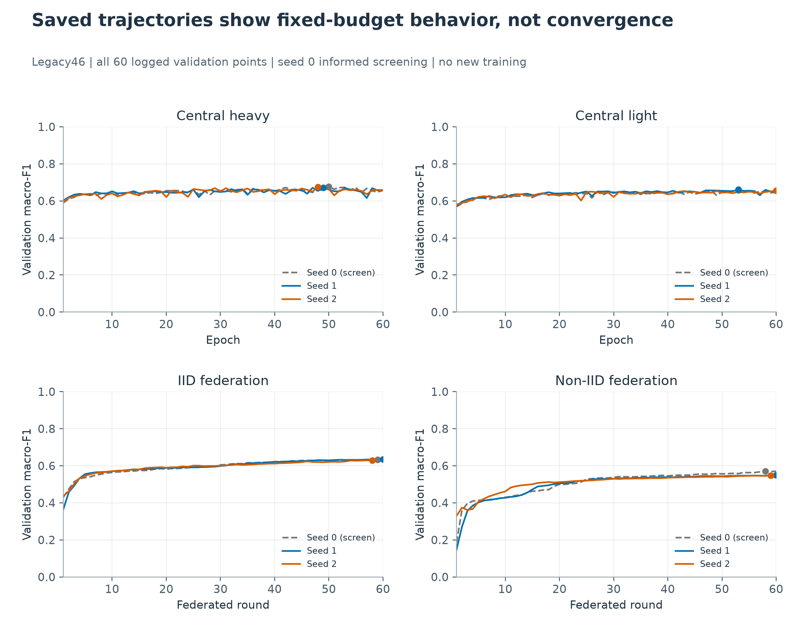

Figure 4. All 720 points come from the twelve saved, checksummed result logs. Dots mark each run's selected checkpoint. Lines connect actual successive validation measurements; no smoothing or new training was used. Epochs and federated rounds are different work units.

Several selected endpoints occur near the budget boundary. Central-light seed 2, IID seed 1 and non-IID seed 1 select step 60, while other federated runs select steps 58 or 59. The data establish performance within the fixed budget, not completed convergence. Extending training based on the same validation observations would constitute another development experiment.

These curves belong only to the original 46-feature study. The final shared-optimizer runs did not save validation scores at every update, so comparable optimizer convergence traces are unavailable. Endpoint scores and progress counters cannot reconstruct them.

<!-- pagebreak -->

## 8. Cloud controls and why the investigation changed direction

The later cloud controls give all three light lanes LayerNorm with dropout 0.2, retaining the original partial-release splits. At seeds 7, 8 and 9, centralized-light mean validation macro-F1 is 0.6872, IID is 0.6345 and non-IID is 0.5559. Mean benign false alerts are 20.99%, 25.50% and 4.27%. The central-light advantage therefore persists in this more closely aligned architecture comparison, although the cloud study still uses repeated validation and fixed training budgets.

| Exploratory cloud control | Validation macro-F1 | Benign false alerts | Interpretation |
| --- | ---: | ---: | --- |
| FedAvg reference, seed 7 | 0.5525 | 3.56% | Paired non-IID reference |
| FedAvg at 120 rounds | 0.5769 | 4.22% | Some categories improve, but the DDoS recall guardrail fails |
| Inverse-frequency weighting | 0.5567 | 3.40% | More rare predictions, but low precision and losses elsewhere |
| FedProx coefficient 0.01 | 0.5570 | 4.38% | Insufficient gain under the frozen promotion criteria |
| FedProx coefficient 0.1 | 0.5775 | 12.55% | Higher aggregate score with much larger alarm burden |

These are developmental controls, not additional independent test results. The larger FedProx coefficient improves macro-F1 but raises false alerts by approximately nine percentage points. A higher score alone does not make the intervention useful. Two further client partitions also retain serious minority-class weaknesses; the easiest partition was not selected as the reference.

Feature diagnostics found marked differences between training and validation distributions for quantities such as IAT, Number and Weight. Those patterns motivated checking the release and representation, but do not by themselves prove corruption, leakage or indistinguishability. The upstream split was retained. The subsequent official39 experiment was explicitly separate rather than silently replacing this evidence. Sources: [cloud study](../cloud_study_2026_10_06/README.md) and [FedProx diagnostic findings](../cloud_analysis_2026_10_06/results/README.md).

<!-- pagebreak -->

## 9. Official39 data controls and final baseline

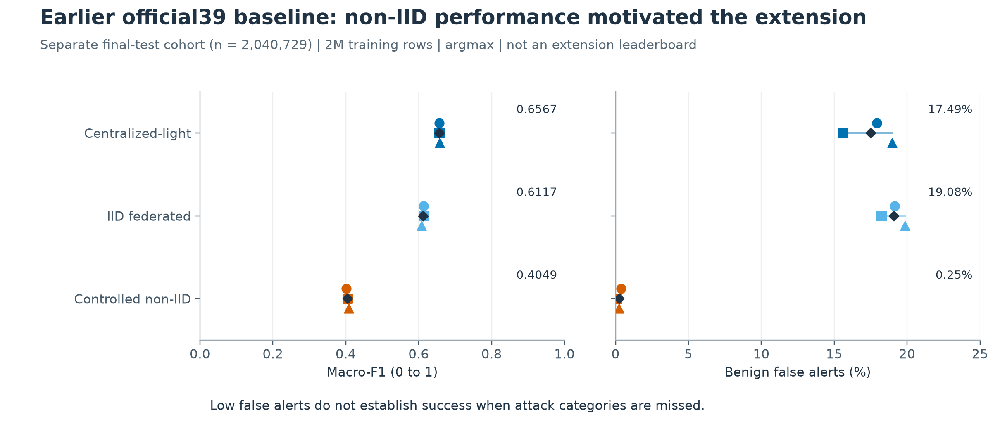

Figure 5. This completed study uses two million training rows, the common 5,096-parameter light network and fixed step-20 endpoints. The primary final-test population has 2,040,729 rows. Argmax decisions are not calibrated to the later extension's alarm target.

The official39 comparison improves architectural alignment: centralized, IID and controlled non-IID references use the same inference network. Nested client ownership prevents data-scale changes from silently redrawing the non-IID experiment. Three training seeds cover each final lane. Feature masks are separately trained sensitivity controls, not post-test replacements for the full39 references.

Before final scoring, label-blind preparation excluded 20,135 exact model-input matches to training or validation under any mask. It preserved all 2,437 Web-based and 1,310 Brute Force test examples. This protects against one specific overlap mechanism, not broader scenario or capture dependence. All 27 frozen full39/masked models were evaluated; the full39 references remained primary.

Mean final-test macro-F1 is 0.65673 centrally, 0.61169 under IID and 0.40494 under controlled non-IID. The corresponding false-alert rates are 17.49%, 19.08% and 0.25%. Non-IID Web-based and Brute Force recall is exactly zero at every seed. There is no matched official39 heavy arm, so these results cannot establish that a light network replaces a heavy one. Source: [final study closeout](../full_data_extension/final-closeout.md).

<!-- pagebreak -->

## 10. Diagnosing the official39 performance gap

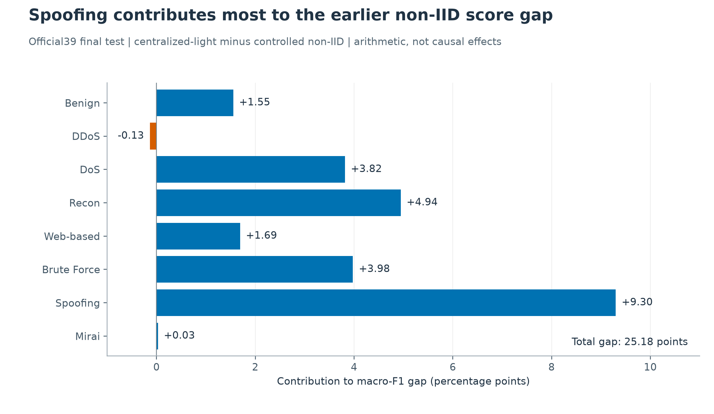

Figure 6. Each contribution is one eighth of the class F1 difference between centralized-light and controlled non-IID, averaged across seeds. Contributions sum to the total gap; they are an arithmetic decomposition, not estimated causal effects.

Spoofing contributes about 9.30 of the 25.18 macro-F1 percentage-point gap. Recon, Brute Force and DoS also contribute materially. Web-based failures are important but do not explain the entire deficit. This redirects the question from finding a specialist for one rare class toward improving how the shared model is updated across heterogeneous clients.

Scaling from 500,000 to two million training rows did not consistently improve the centralized or IID model at equal processed-example budgets. Gains were consistent at 20 passes, which also quadrupled training exposure. Additional unique data and additional optimization work therefore cannot be credited interchangeably. LayerNorm, class weighting, local-update caps, loss-denominator controls and feature masks each addressed a plausible explanation without resolving the full trade-off.

The primary full39 models all contain 5,096 parameters, or 20,384 bytes of FP32 parameter values. Each final run processes 40 million training examples. Recorded GPU training-plus-validation times average about 300-311 seconds across the three lanes, excluding setup and checkpoint I/O. These are single-machine workloads, not distributed network timings or edge-device measurements. Source: [all-class metrics and cost accounting](../federated_class_safeguards/study-synthesis-tables.md).

<!-- pagebreak -->

## 11. Explainability and security interpretation

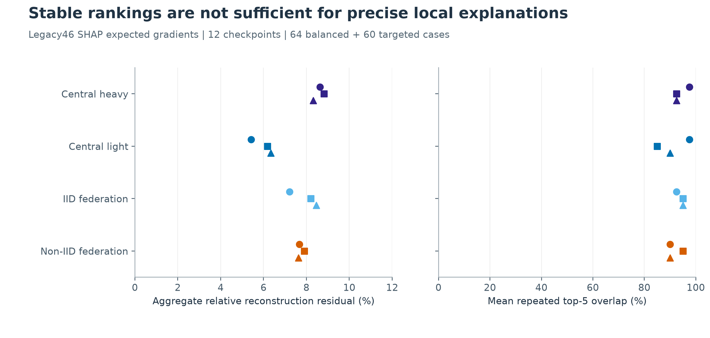

Figure 7. Original-study SHAP expected-gradients diagnostics are shown for all twelve checkpoints. Markers represent seeds 0, 1 and 2. Reconstruction residuals and repeat overlaps answer different numerical questions; neither is a predictive performance metric.

The original SHAP study uses a shared 64-case balanced core and a separate 60-case targeted supplement, with 128 training-background rows. Two Monte Carlo repeats use 256 integration samples each. Aggregate relative reconstruction residuals are approximately 5.4-8.8%, even when repeated feature rankings overlap strongly. Some individual residuals are large relative to the decision margin, so stable ranking alone cannot justify a precise signed explanation of an error.

The official39 explanation study instead uses background-averaged integrated gradients on 219 selected validation cases across seven checkpoints. It includes three centralized and three IID seeds, but only one non-IID seed. Numerical reconstruction and resolution checks pass. Number ranks first in every model's balanced-core summary; protocol, flag and size features also recur. Reference-background sensitivity and correlated features limit independent interpretation of those contributions.

The resulting security implications are modest but useful. A benign prediction should not be treated as proof that rare web or authentication activity is safe. Repeated flow-feature associations can motivate inspection of the extractor and independent application telemetry. They do not establish numerical firewall rules, causal attack mechanisms or vulnerable device types. These interpretation limits do not insert a human-review stage into the classifier or claim a performance gain from one. Sources: [original attribution evidence](../explanations_2026_10_05/results/README.md) and [official39 explanation study](../full_data_extension/explanation-study.md).

<!-- pagebreak -->
## 12. Training designs and fairness of the comparison

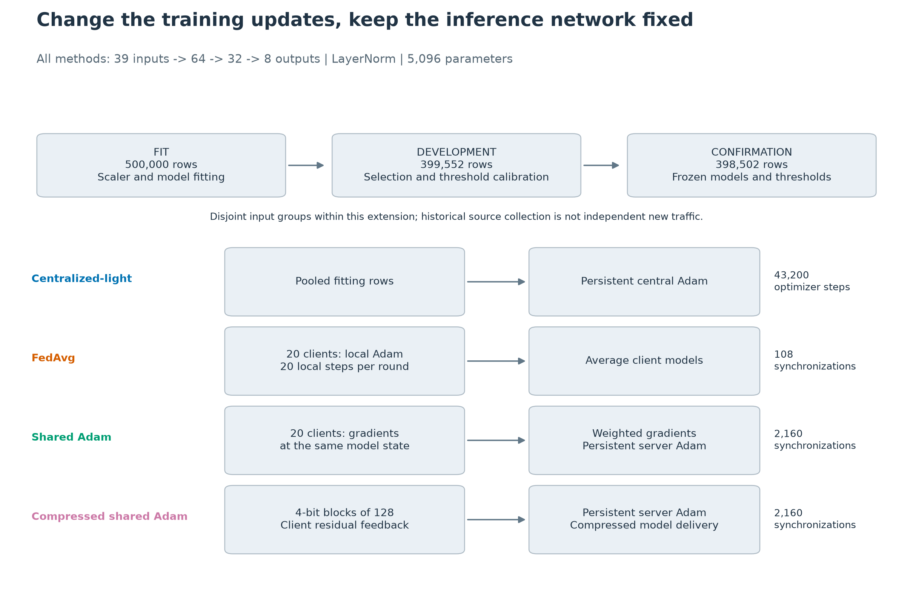

Figure 8. All methods use one inference architecture. Top arrows show workflow order, not movement of rows between cohorts. The lower diagrams describe a single-machine simulation, not physical networking.

The network maps 39 standardized inputs through hidden layers of 64 and 32 units to eight classes. LayerNorm is used without dropout. The fitting-only scaler is shared across methods. A square-root class-weighted cross-entropy loss uses one fixed training-mean denominator. Twenty virtual clients retain one fixed non-IID ownership partition. Each endpoint processes 21.6 million training examples; this is not equality of FLOPs, wall time, effective batch size or optimization trajectory.

The FedAvg control performs 20 local Adam steps before model averaging and resets each client optimizer at the start of a round. Centralized-light retains a pooled Adam optimizer. Shared Adam combines population-weighted client gradients at each synchronization and applies one persistent server Adam update. It uses 2,160 synchronized updates, whereas centralized Adam performs 43,200 minibatch updates and FedAvg uses 108 communication rounds. Consequently, this comparison changes optimizer placement and update scheduling together; it cannot attribute the entire gain to optimizer memory alone.

Federated averaging follows the iterative model-aggregation principle introduced by [McMahan et al. (2017)](https://proceedings.mlr.press/v54/mcmahan17a.html). Adam uses adaptive first- and second-moment estimates [Kingma and Ba (2015)](https://arxiv.org/abs/1412.6980). These mechanisms are established prior work; the experimental contribution here is their controlled comparison for this task.

<!-- pagebreak -->

## 13. Cohort construction and evaluation controls

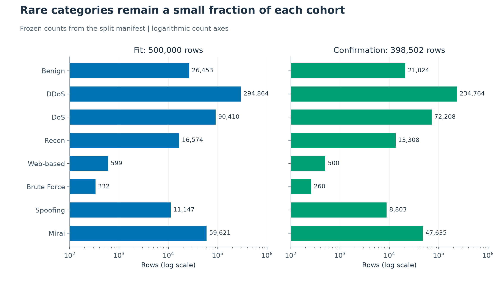

Figure 9. Counts use logarithmic axes to keep rare classes visible. They are cohort sizes, not counts multiplied by the number of model seeds.

A two-million-row historical training view supplied the extension. A deterministic raw-feature hash assigned fitting-eligible, development and confirmation membership. Exactly 500,000 rows were retained for fitting, 399,552 for development and 398,502 for confirmation after the predeclared precision-collision rule. Scaling was fitted only on the fitting rows. Standardized feature groups crossing cohort boundaries were removed with fitting taking priority, then development, then confirmation. No such cross-cohort groups remained.

Development data supported method choices and benign-alarm calibration. For each model, an attack score is the largest attack logit minus the benign logit. The highest-scoring attack category is predicted only when that score strictly exceeds the fixed threshold; threshold ties remain benign. Thresholds were calibrated at 1%, 5%, 10% and 20% benign false-alert targets. The primary comparison was fixed at 5% before confirmation opened.

The twelve checkpoints cover four methods at training seeds 7, 17 and 27. No checkpoint, seed, threshold or scaler was selected again on confirmation. The cohort contains only 500 Web-based and 260 Brute Force rows, making their counts particularly important. The same rows are scored by all models, so three training seeds do not constitute three independent datasets. Historical use of the underlying collection also limits the strength of any generalization claim.

<!-- pagebreak -->

## 14. Primary confirmation performance

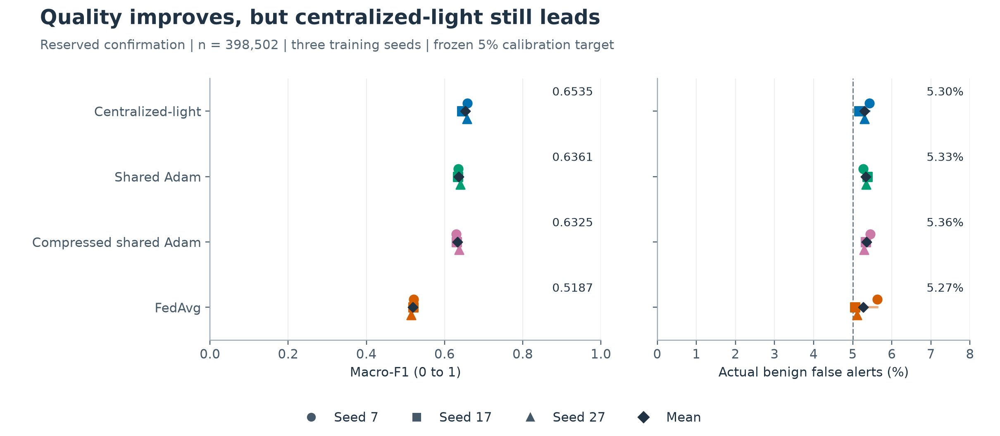

Figure 10. Small markers identify individual training seeds; black diamonds show means. Connecting spans show the observed range, not confidence intervals. The dashed line marks the development calibration target, not a guaranteed confirmation rate.

| Method | Macro-F1 mean | Sample SD | Actual false alerts |
| --- | ---: | ---: | ---: |
| Centralized-light Adam | 0.6535 | 0.0076 | 5.30% |
| Shared Adam | 0.6361 | 0.0033 | 5.33% |
| Compressed shared Adam | 0.6325 | 0.0038 | 5.36% |
| FedAvg with client Adam | 0.5187 | 0.0033 | 5.27% |

Compressed shared Adam improved mean macro-F1 by 11.39 percentage points over FedAvg, retained all but 0.36 points of uncompressed shared Adam's quality, and remained 2.10 points below centralized-light. It closed approximately 84.4% of the mean FedAvg-to-centralized gap. This describes closeness in this comparison, not statistical equivalence. Centralized gaps at seeds 7, 17 and 27 were 2.80, 1.44 and 2.06 points respectively.

All primary compressed-versus-reference comparisons had actual false-alert differences within the predeclared 0.5-percentage-point allowance. Nevertheless, compressed-model actual rates ranged from 5.29% to 5.45%. The method therefore does not meet a strict deployment requirement of at most 5% false alerts. Three-seed sample standard deviations describe training variation, not uncertainty across devices, captures or client partitions.

<!-- pagebreak -->

## 15. Coverage across the eight classes

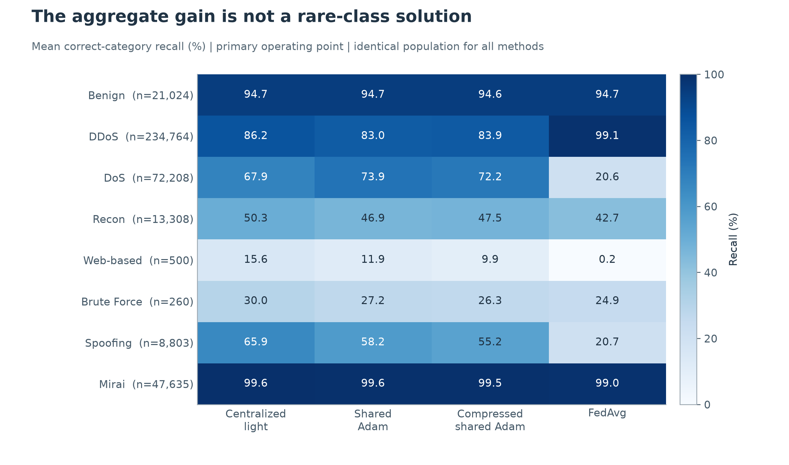

Figure 11. Cells show equal-weight means of correct-category recall across seeds. Every class shares a 0-100% color scale. Supports refer to one confirmation population.

The macro-F1 improvement is not confined to the two rarest categories. Compared with FedAvg, compressed shared Adam raises mean DoS recall from 20.61% to 72.25% and Spoofing recall from 20.66% to 55.17%. Recon also improves, from 42.70% to 47.53%. These changes recover useful coverage of categories that FedAvg handles poorly in this fixed non-IID configuration.

The improvement is not classwise dominance. DDoS recall falls from FedAvg's 99.07% to 83.93%, while Mirai remains near 99.5%. Web-based recall rises from almost zero but remains below 10%; Brute Force recall reaches 26.28%, compared with 24.87% for FedAvg and 30.00% centrally. A statement that the method "solves rare attacks" would therefore be inconsistent with the observed results.

Macro-F1 is useful because it gives each class equal weight, but it cannot replace class-level inspection. High detection rates for common attacks can coexist with serious minority-class failures, and a benign false-alert rate must be reported alongside category performance.

<!-- pagebreak -->

## 16. Error destinations and interpretation

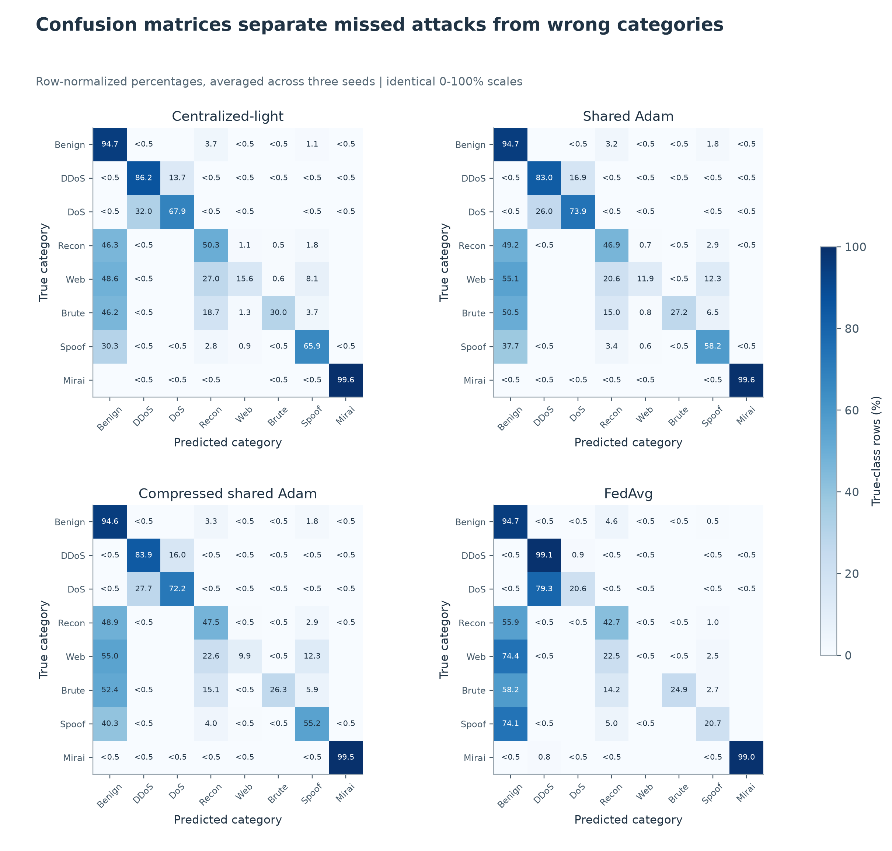

Figure 12. True classes are rows and predicted classes are columns. Each matrix averages three row-normalized matrices with identical supports. Blank cells are exact zero; small nonzero cells are marked below 0.5%. The common color scale permits method comparisons.

The benign column distinguishes suppressed attack alerts from incorrect attack labels. A DoS flow predicted as DDoS remains an eight-class error, but can still raise an attack alarm. A flow predicted as benign may not raise one. This distinction explains why binary attack-detection recall can look strong even when macro-F1 and rare-category identification remain inadequate.

<!-- pagebreak -->

## 17. Rare-class detection and identification are different tasks

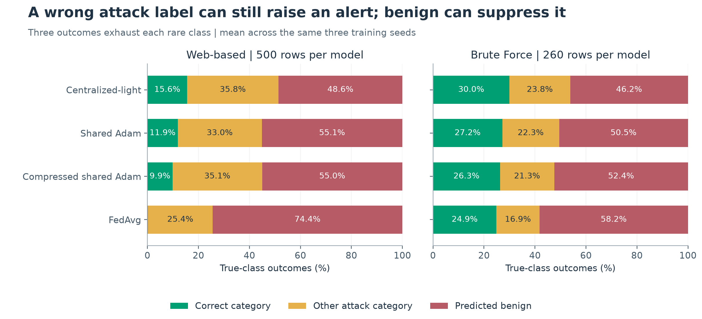

Figure 13. The three outcomes sum to 100% for each method and class. Correct identification is a subset of all attack alerts; the red segment represents missed attacks predicted benign.

Compressed shared Adam correctly identifies 41, 42 and 65 of the 500 Web-based examples at the three seeds. For Brute Force, the corresponding counts are 66, 73 and 66 out of 260. In mean terms, 45.0% of Web-based examples receive some attack label, but only 9.87% receive the correct category. Brute Force attack-alarm recall is 47.56%, compared with 26.28% correct-category recall.

Its overall binary attack-detection recall is 97.22%, heavily influenced by common classes. Presenting that value as the headline would conceal the remaining rare-class problem. Even centralized-light achieves only 15.60% Web-based and 30.00% Brute Force recall. The evidence is compatible with limitations in representation, overlap or available minority information, but this experiment does not isolate their causes.

Compression can also have a meaningful local cost while passing an aggregate safeguard. At seed 17, Web-based recall falls from uncompressed shared Adam's 12.6% to 8.4%: 21 fewer correctly identified examples. This remains within the predeclared five-percentage-point tolerance, but should not be described as "no loss."

<!-- pagebreak -->

## 18. Compression and communication trade-offs

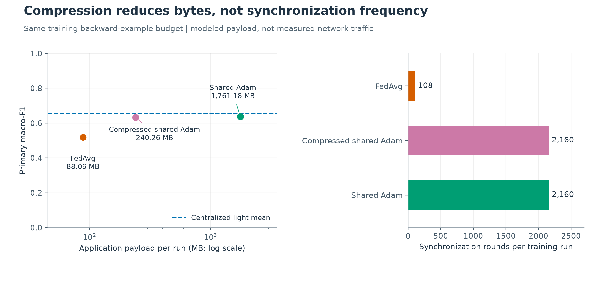

Figure 14. Left: mean primary macro-F1 with sample SD, against counted application payload on a logarithmic axis. Right: synchronization counts. The centralized reference line represents quality only; centralized raw-data collection cost is unknown, not zero.

The compressed method quantizes consecutive blocks of 128 tensor coordinates using a block scale and symmetric four-bit values. Client residual feedback retains the difference between the corrected gradient and its transmitted approximation. The server keeps full-precision Adam moments and a target model; compressed target-minus-delivered updates carry undelivered information into later broadcasts. Gradients are computed at the delivered approximation, so the compressed trajectory is not mathematically identical to full-precision Adam.

Error feedback has established foundations in gradient-compression research [Karimireddy et al. (2019)](https://proceedings.mlr.press/v97/karimireddy19a.html). That motivates retaining omitted information; it does not transfer an EF-SGD convergence theorem automatically to this compressed Adam implementation.

| Federated method | Application payload | Synchronizations |
| --- | ---: | ---: |
| Shared Adam | 1,761.18 MB | 2,160 |
| Compressed shared Adam | 240.26 MB | 2,160 |
| FedAvg | 88.06 MB | 108 |

Compression saves 86.4% of historical shared-gradient payload but still uses 2.73 times the FedAvg payload and 20 times its synchronization rounds. Serialized compressed accounting includes startup and message metadata; the historical raw baselines do not. These are application-byte counts, not measured network traffic, latency, energy or privacy. The trade-off could be unfavorable on high-latency or intermittently connected clients despite improved macro-F1.

<!-- pagebreak -->

## 19. Operating points and fixed success criteria

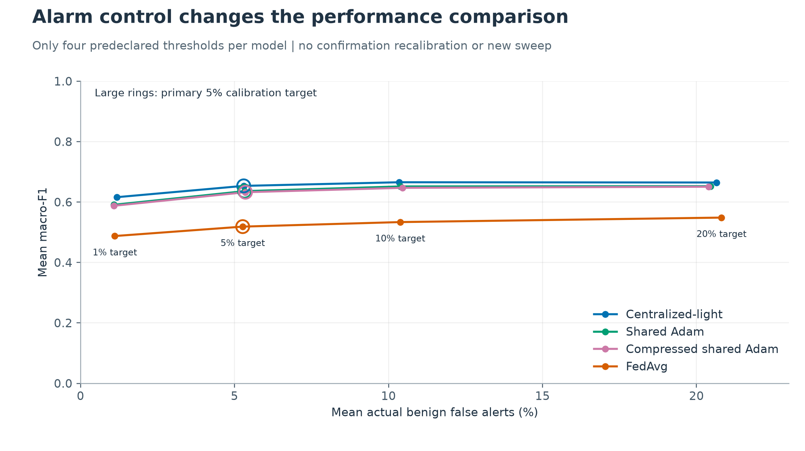

Figure 15. Points show actual confirmation rates at thresholds previously fixed on development. Lines connect four observed points only; they are neither fitted curves nor an ROC analysis. Large rings mark the primary target. No new threshold sweep was performed.

Ordinary argmax produces compressed-model mean macro-F1 of 0.6513 with 17.91% benign false alerts. Centralized-light gives 0.6646 and 20.28%, whereas FedAvg gives 0.4888 and 1.17%. Those raw results represent materially different alarm burdens. The primary calibrated comparison reduces that mismatch and retains a substantial federated quality gain.

Each seed independently passed the unchanged five safeguards: at most one macro-F1 point lost to shared Adam; at most 0.5 points of actual false-alert difference from shared Adam; no class losing more than five recall points; at least eight F1 points gained over FedAvg; and at most 15% of historical shared-gradient payload. A favorable mean was not used to rescue a failed seed. These are engineering tolerances, not statistical equivalence tests or operational deployment gates.

At the secondary 20% target, actual false-alert differences exceed the 0.5-point comparability allowance for seed 17 versus shared Adam and FedAvg, and seed 27 versus shared Adam. Those secondary comparisons are not alarm-matched. They do not change the primary conclusion, and no secondary threshold was promoted after confirmation.

<!-- pagebreak -->

## 20. Overall validity and limitations

### Comparability within and between studies

The original configured-model comparison changes normalization and dropout as well as architecture or training location. Its seed-0 recipes were screened before new seeds were run, and all endpoints were selected on reused validation data. Its strengths are explicit configuration records, complete trajectories and honest seed-level reporting; it is not an isolated causal estimate of federation or model size.

The official39 baseline improves architecture matching and fixes final endpoints before scoring. Its duplicate-group and exact-input checks address direct overlap, while its common test population supports paired comparisons. Nevertheless, within-collection splitting is not equivalent to evaluating future traffic, new capture sessions or new devices. The absence of a matched heavy model limits conclusions about model replacement.

The optimizer extension freezes twelve checkpoints and 48 calibrated thresholds before confirmation. Each checkpoint reproduces its saved development predictions, and all final metrics are independently recomputed from saved outputs. However, shared optimization changes update frequency and effective batching along with optimizer placement. FedAvg uses a particular reset-client Adam design. Three training seeds share one client partition and the same examples. These choices delimit the positive finding rather than establishing general superiority over federated averaging.

The earlier default-argmax development screen failed its complete continuation criteria, despite shared Adam's high macro-F1. A separately specified alarm-calibrated diagnostic then asked a different question, followed by seed replication and compression safeguards fixed before confirmation. The final success does not retroactively turn the original failed screen into a pass. This distinction preserves the development history and avoids presenting the final protocol as the only question ever tested. Sources: [original screen](../federated_shared_optimizer/performance-findings.md) and [separate alarm diagnostic](../federated_shared_optimizer/alarm-findings.md).

### Resource and security limits

The clients are simulated on a single machine. No physical communication delay, straggler behavior, energy consumption or edge inference latency was measured. Parameter size and application-byte accounting should not be substituted for those quantities. Gradient sharing is still distributed-data training in the simulated algorithm, but does not itself guarantee privacy; pooled preprocessing and global class counts are explicit simplifying assumptions.

All studies retain substantial class-specific failures. The optimizer extension's actual false alerts exceed its nominal 5% calibration target, and its Web-based recall remains below 10%. The fact that every predeclared research safeguard passes does not make the model operationally safe. Deployment thresholds and incident-response policies would require a separate operational validation design.

### Interpretation and experimental reuse

Attributions explain model behavior relative to selected backgrounds, not causes in the network. Correlated inputs and interpolation through unrealistic feature combinations complicate interpretation. The balanced explanation samples are diagnostic rather than prevalence-weighted performance samples. Earlier use of the underlying collection also limits how independent the final extension's reserved confirmation can be considered. Further tuning on either exposed final population would require a newly labeled development study and fresh evaluation evidence.

<!-- pagebreak -->

## 21. Discussion of the research questions

### Compactness does not establish deployability

The original heavy network's roughly 36-fold parameter increase yields a modest configured-model macro-F1 advantage. This supports retaining a compact model as a serious research reference. It does not show that the light model is equivalent centrally, that the heavier architecture is unnecessary under every protocol, or that either model meets an operational requirement. Their false-alert and minority-class results are central to the trade-off, not incidental caveats.

### Heterogeneity affects more than the rarest categories

The official39 IID model performs much closer to centralized-light than the controlled non-IID model. The class decomposition shows that Spoofing, Recon and DoS contribute substantial losses alongside rare attacks. This makes the update procedure a reasonable target for investigation. The evidence does not isolate label mixture as the only cause: optimizer state, local trajectories, class weights and representation remain coupled to the observed setting.

### Shared optimization offers the strongest confirmed improvement

Against the extension's own FedAvg reference, compressed shared Adam gains 11.39 macro-F1 points and closes approximately 84.4% of the mean gap to centralized-light. Only 0.36 points are lost relative to uncompressed shared Adam. The safeguards pass separately at all three seeds, preventing a favorable aggregate from hiding a failed seed. These are the strongest grounds for treating the extension as a useful contribution.

The costs are equally concrete. Compression reduces bytes but not the 2,160 synchronizations, compared with 108 for FedAvg. Its application payload remains 2.73 times FedAvg's. On high-latency networks, the quality improvement may therefore be expensive. No claim of universal communication efficiency follows from the 86.4% saving relative to the more communication-intensive uncompressed reference.

### Explanations support investigation rather than automatic policy

The explanation work reveals recurring feature dependence and warns against converting a visually compelling ranking into a security rule. Numerical residual checks are important because an approximate explanation can appear stable while failing to reconstruct the decision margin closely. Feature masking and background checks provide sensitivity evidence, not proof that a feature is causal or entirely spurious.

The study's coherent outcome is therefore a measured compromise: compact inference remains possible, a shared update design recovers much of the non-IID quality gap, and compression makes that design smaller in bytes. Rare-class reliability, alarm burden and synchronization remain open constraints. That is a more defensible result than either declaring federated learning unsuccessful in general or claiming that the final model solves intrusion detection.

<!-- pagebreak -->

## 22. Conclusion and future work

Tradecraft investigated centralized-heavy, centralized-light and simulated federated-light intrusion classification using an eight-class CICIoT2023 task. The original configured-model study established a modest aggregate benefit from a much larger network and persistent non-IID class failures. The official39 baseline strengthened architectural matching and final evaluation, but retained large heterogeneous-client losses and weak rare-category recognition.

The final shared-optimizer extension provides a positive result within those limits. A persistent shared Adam update with four-bit blockwise residual-feedback compression reaches mean confirmation macro-F1 of 0.6325, compared with 0.5187 for the paired FedAvg control and 0.6535 centrally, at similar observed primary alarm rates. Compression saves 86.4% of the uncompressed shared-gradient payload while preserving most of its predictive quality. Frequent synchronization and minority-class failures remain important costs.

The project demonstrates the value of treating evaluation design as part of model engineering. Shared feature schemas, work counters, exact recovery checks, frozen candidates, alarm calibration and class-level diagnostics make the final findings more interpretable than a sequence of best-score reports. The algorithmic components are grounded in existing optimization and compression methods; the contribution is their verified comparison and application-specific quality-cost analysis.

The next research priorities are independent capture-session evaluation, repeated non-IID partitions and measured network-delay experiments. Ablations that hold effective batching and synchronization schedules fixed could distinguish optimizer-memory effects from scheduling effects. Secure aggregation, private preprocessing or partial participation would need explicit new designs rather than being inferred from the present simulation. Any future rare-class method should report correct-category recall, missed attacks and false alerts together.

These are future studies, not prerequisites for reporting the completed results and not a reason to spend remaining cloud credits without a hypothesis. The current confirmation set has been opened. It should remain a record of the locked experiment, not become another hidden tuning resource.

<!-- pagebreak -->

## References

1. Canadian Institute for Cybersecurity. CIC IoT Dataset 2023. Dataset description and attack taxonomy. [Official release documentation](https://www.unb.ca/cic/datasets/iotdataset-2023.html).
2. Diaz-Gorrin, J., Caballero-Gil, C., and Brankovic, L. (2026). Enhancing Network Security with Generative AI on Jetson Orin Nano. Applied Sciences, 16(3), 1442. [DOI](https://doi.org/10.3390/app16031442).
3. McMahan, B., Moore, E., Ramage, D., Hampson, S., and Aguera y Arcas, B. (2017). Communication-Efficient Learning of Deep Networks from Decentralized Data. AISTATS, PMLR 54, 1273-1282. [Primary paper](https://proceedings.mlr.press/v54/mcmahan17a.html).
4. Kingma, D. P., and Ba, J. (2015). Adam: A Method for Stochastic Optimization. ICLR. [Primary paper](https://arxiv.org/abs/1412.6980).
5. Karimireddy, S. P., Rebjock, Q., Stich, S., and Jaggi, M. (2019). Error Feedback Fixes SignSGD and other Gradient Compression Schemes. ICML, PMLR 97, 3252-3261. [Primary paper](https://proceedings.mlr.press/v97/karimireddy19a.html).
6. Sundararajan, M., Taly, A., and Yan, Q. (2017). Axiomatic Attribution for Deep Networks. ICML, PMLR 70, 3319-3328. [Primary paper](https://proceedings.mlr.press/v70/sundararajan17a.html).
7. SHAP developers. GradientExplainer documentation. Expected gradients and reference-background semantics. [Official documentation](https://shap.readthedocs.io/en/latest/generated/shap.GradientExplainer.html).
8. Tradecraft. Original configured-model seed-stability study. [Protocol and findings](../confirmation_2026_10_05/README.md), [aggregate evidence](../confirmation_2026_10_05/results/summary.json).
9. Tradecraft. Cloud controls and FedProx analysis. [Cloud study](../cloud_study_2026_10_06/README.md), [diagnostic analysis](../cloud_analysis_2026_10_06/results/README.md).
10. Tradecraft. Official39 final evaluation and explanations. [Final closeout](../full_data_extension/final-closeout.md), [class-level synthesis](../federated_class_safeguards/study-synthesis-tables.md), [explanation findings](../full_data_extension/explanation-study.md).
11. Tradecraft. Shared-optimizer reserved confirmation. [Frozen execution plan](../federated_shared_optimizer/confirmation-execution-plan.json), [audited results](../federated_shared_optimizer/confirmation-results.json), [final findings](../federated_shared_optimizer/confirmation-findings.md).

### Reproducibility note

The editable manuscript is assembled from checked-in context and discussion sections plus the reviewed optimizer chapter. Fifteen figures combine six new aggregate-evidence plots with nine existing optimizer/baseline figures. Original training curves use a portable export of 720 verified saved validation points. The figures do not require model fitting, checkpoint loading or new test inference. Figure and assembly manifests record exact source identities. The PDF is a review copy outside Git; source text and vector figures remain editable.
